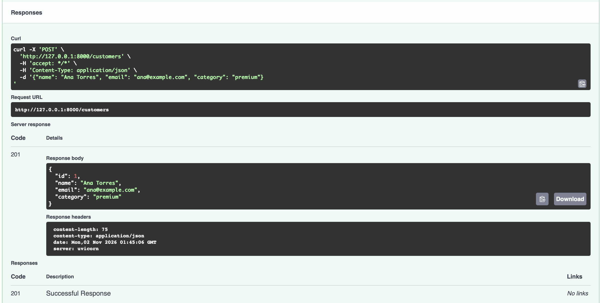
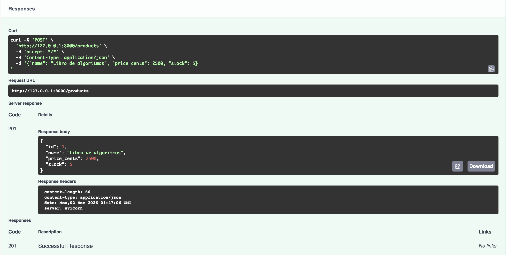
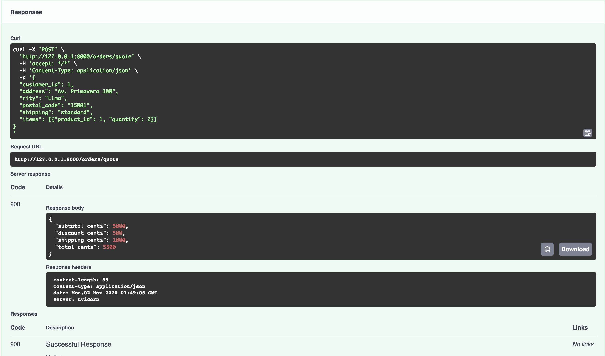
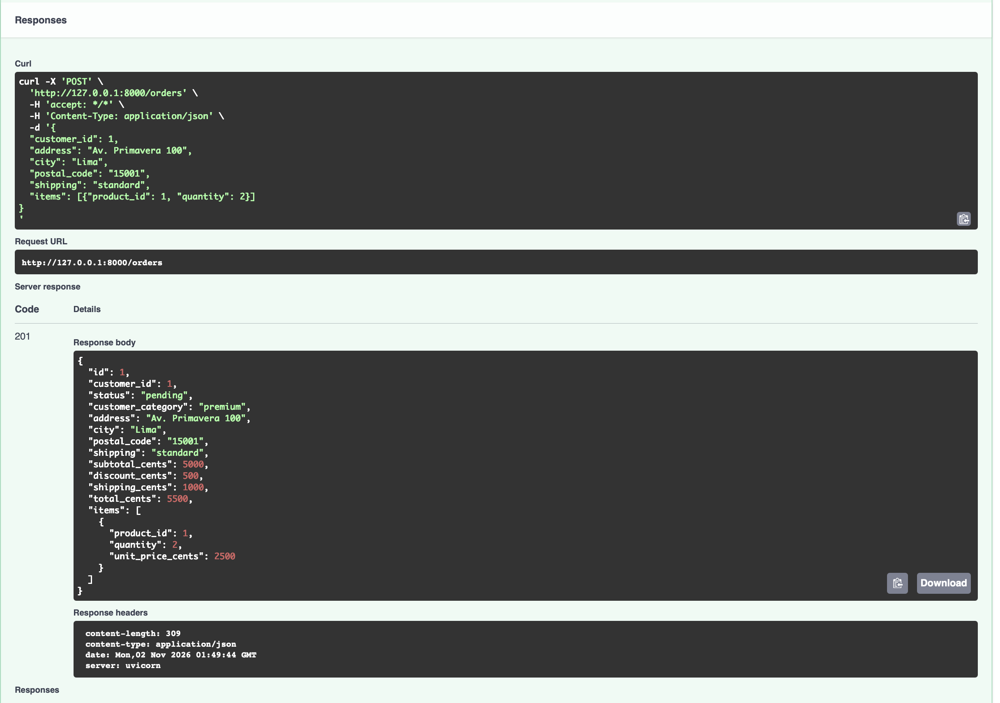
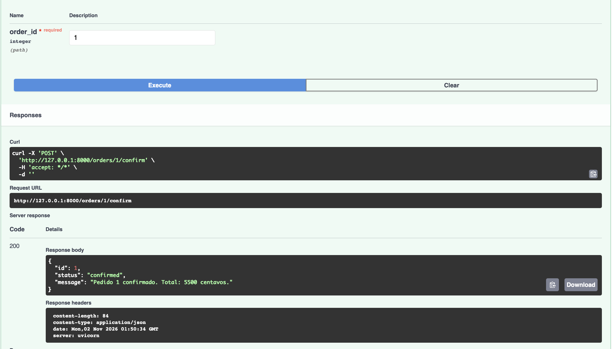
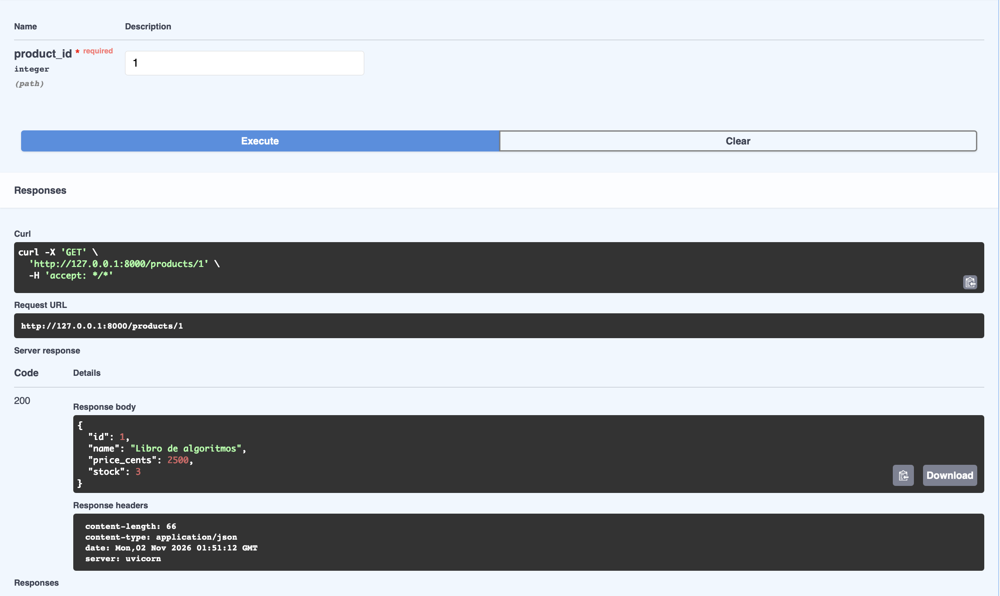
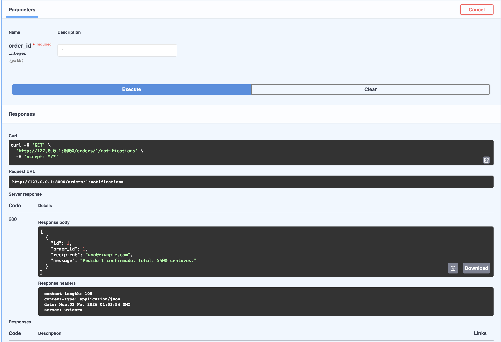
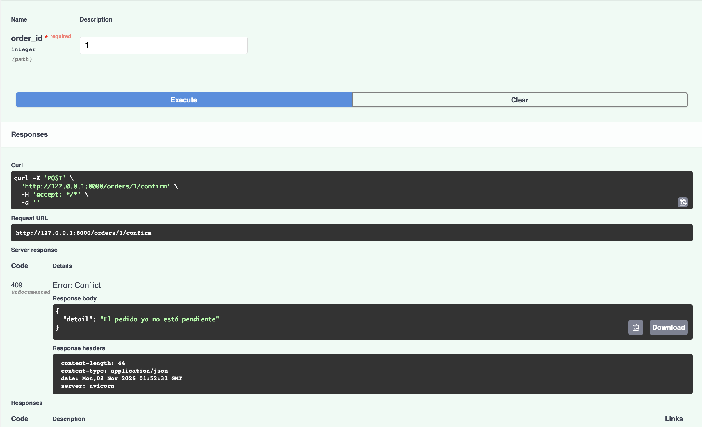

# 1. Ejecución de la aplicación

## Versiones

- Python 3.14.6
- uv 0.13.6

## Ejecución

```bash
uv sync --locked
uv run main.py
```

## Recorrido inicial

1. `POST /customers` → `201`

```json
{"id":1,"name":"Ana Torres","email":"ana@example.com","category":"premium"}
```

2. `POST /products` → `201`

```json
{"id":1,"name":"Libro de algoritmos","price_cents":2500,"stock":5}
```

3. `POST /orders/quote` → `200`

```json
{"subtotal_cents":5000,"discount_cents":500,"shipping_cents":1000,"total_cents":5500}
```

`POST /orders` → `201`

```json
{"id":1,"customer_id":1,"status":"pending","customer_category":"premium","address":"Av. Primavera 100","city":"Lima","postal_code":"15001","shipping":"standard","subtotal_cents":5000,"discount_cents":500,"shipping_cents":1000,"total_cents":5500,"items":[{"product_id":1,"quantity":2,"unit_price_cents":2500}]}
```

4. `POST /orders/1/confirm` → `200`

```json
{"id":1,"status":"confirmed","message":"Pedido 1 confirmado. Total: 5500 centavos."}
```

5. `GET /products/1` → `200`

```json
{"id":1,"name":"Libro de algoritmos","price_cents":2500,"stock":3}
```

6. `GET /orders/1/notifications` → `200`

```json
[{"id":1,"order_id":1,"recipient":"ana@example.com","message":"Pedido 1 confirmado. Total: 5500 centavos."}]
```

7. `POST /orders/1/confirm` (repetido) → `409`

```json
{"detail":"El pedido ya no está pendiente"}
```

`GET /products/1` después del `409`: el stock sigue en `3`.


## Evidencia de API en funcionamiento

1.


2.


3.




4.


5.


6.


7.
