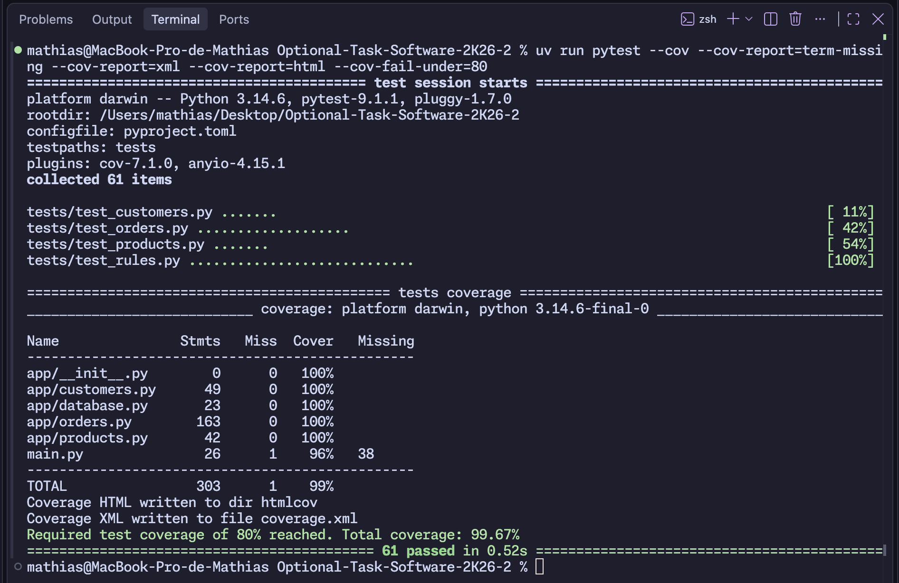
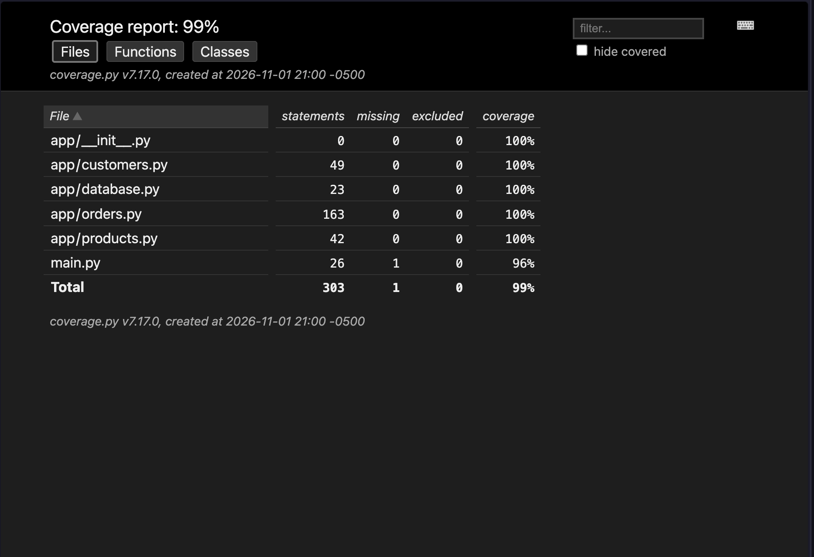

# 2. Escribir pruebas

Se pasó de 4 pruebas (67 %) a 61 pruebas (99 %).

- `test_rules.py`: pruebas unitarias de descuentos, envíos, totales y validaciones.
- `test_products.py` y `test_customers.py`: CRUD, errores 404/409/422 y persistencia.
- `test_orders.py`: se agregaron casos de edición, cancelación, eliminación, estados y stock.

