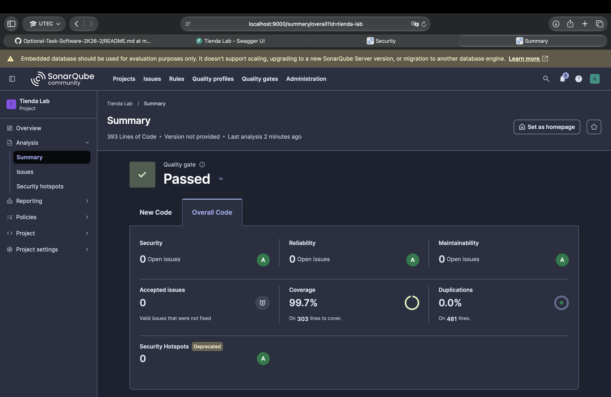
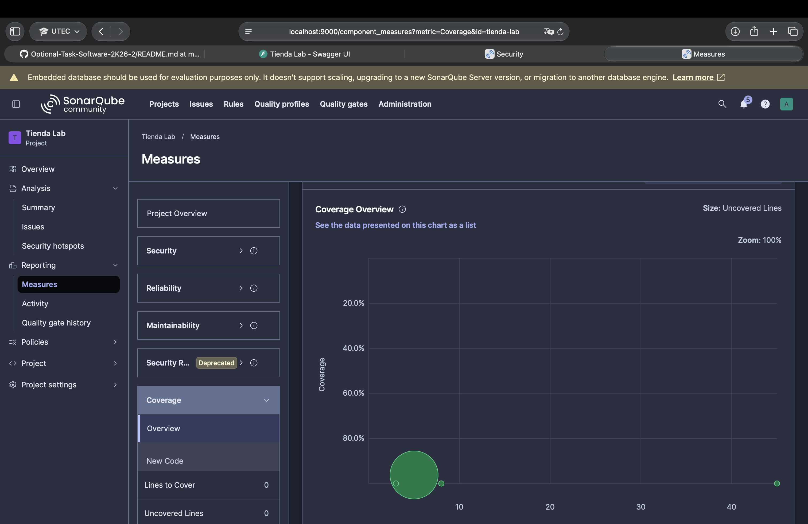
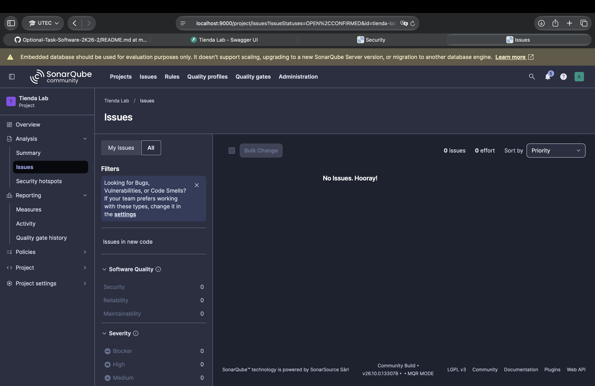
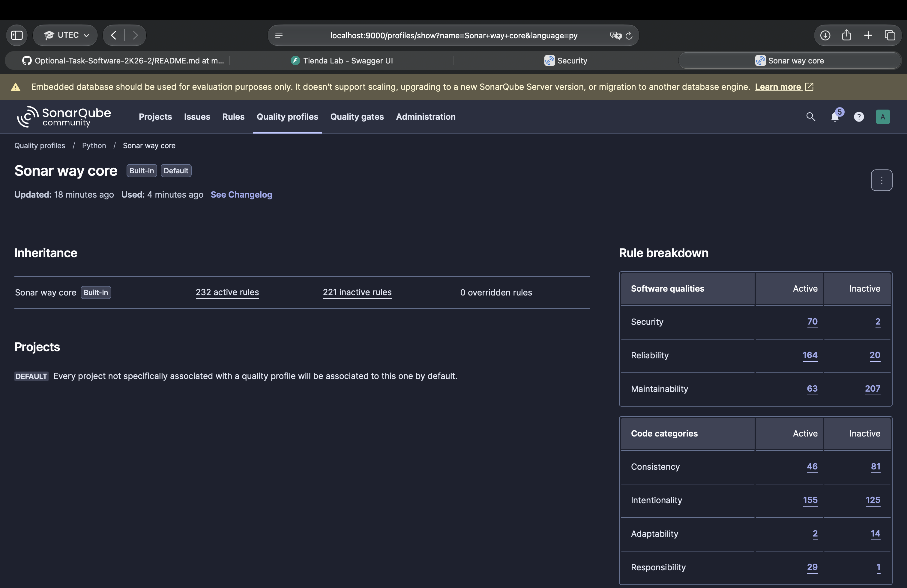

# 3. SonarQube (análisis inicial)

- SonarQube Community Build 26.10.0.133078
- Perfil de calidad: Sonar way core (Python)
- Quality Gate: Passed
- Cobertura global: 99,7 % (303 líneas)
- Issues: 0

SonarQube no reporta hallazgos con el perfil por defecto, pero el código sí tiene code smells de diseño (lógica duplicada, métodos largos, etc.), que se analizan en el punto 4.

