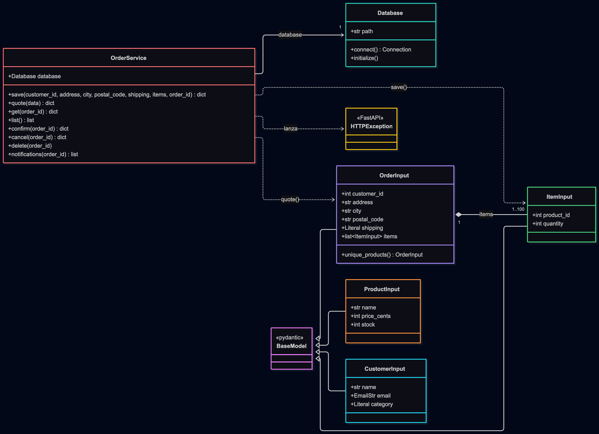
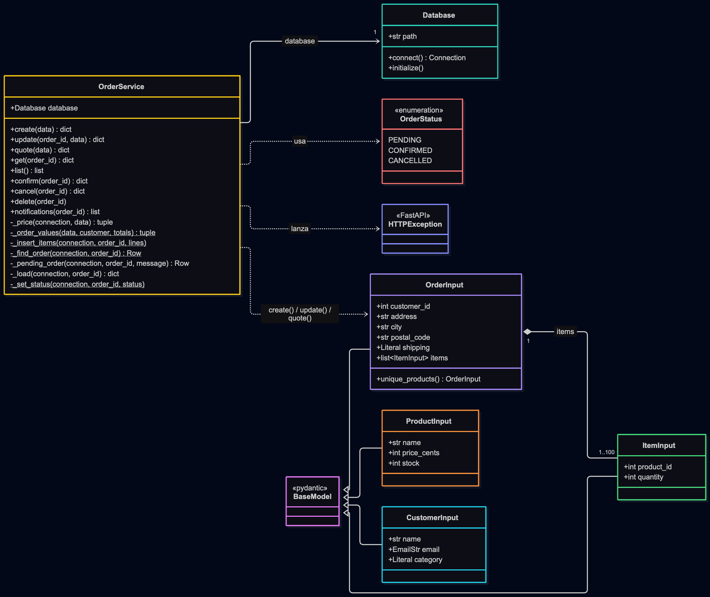

# 6. Diagramas de clases

Fuentes en Mermaid: `docs/diagramas/clases_inicial.mmd` y `docs/diagramas/clases_final.mmd`.

Solo se dibujan clases reales del código. Las rutas de FastAPI y `calculate_totals` son funciones de módulo, no clases.

## Inicial (`v1-inicial`)

## Final (`v2-final`)

Cambios: `save` se divide en `create` y `update`, ambos reciben `OrderInput`; aparecen los métodos privados extraídos y el enum `OrderStatus`. `_price()` usa la función `calculate_totals()` y las constantes de precios del módulo `orders`.
